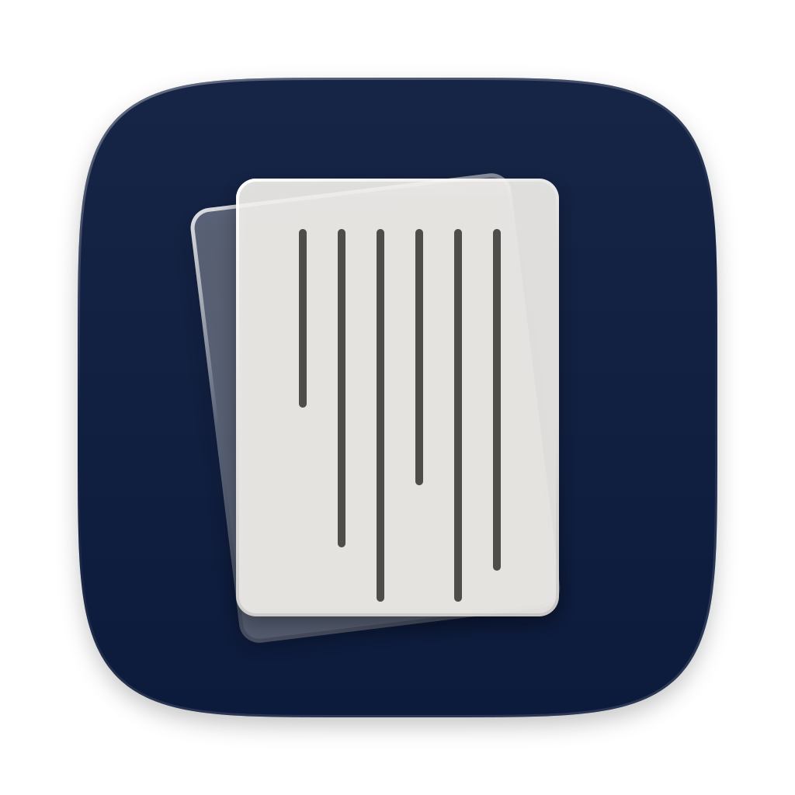

<div align="center">



# Mori Studio

[Mori](https://github.com/Musenxi/Astro-Theme-Mori) 博客的本地写作与排版编辑器

[](https://github.com/Musenxi/Mori-Studio/releases)
[](LICENSE)
[](https://nodejs.org)
[](https://react.dev)
[](https://vite.dev)
[](https://tailwindcss.com)
[](https://ui.shadcn.com)
[](https://tauri.app)
[](https://modelcontextprotocol.io)

</div>

直接读写博客项目里的内容文件，不需要 git。预览、校验、Markdown 转换都用项目自己的主题代码。有命令行版和桌面版（macOS / Windows），也能作为 MCP 服务让 AI 客户端读写博客。

## 功能

- **写作**：Markdown 写正文（第一行 `# 标题`，拖入图片、旁注），自动保存；也可以切到 JSON 源码。分类、标签、摘要、封面、置顶在右侧“信息”面板。保存时按主题的 schema 校验，问题会列出来但不阻止保存。
- **读法与地图**：每篇都能开竖向 / 横向 / 混合读法，选默认读法和横滚方向；打开“地图”后封面有路线图，读到哪里地图跟到哪里，文末有行程表。
- **地点**：选中一个词标成地点，填坐标（也认 Plus Code 和地图网址）、英文名、日期；路线可以导入 GPX，或按照片的拍摄地点生成。
- **排版**：按横向读法把整篇排成一条，直接拖动调整位置、顺序、大小；单图 / 双图 / 图组 / 网格 / 自由排布切换，文字横排或竖排，在排版里直接改字。
- **图片**：按文章分文件夹，导入时查重，HEIC 和实况照片自动转换；可以压缩后上传到 S3 兼容的图床（Cloudflare R2、阿里云 OSS、腾讯云 COS、七牛云、AWS S3）。
- **页面**：独立页（“关于”“留言”）、页头入口、友人帐（粘贴网址自动带出站名、简介、头像）。
- **评论**：接入自建评论服务 [Mori-Comment](https://github.com/Musenxi/Mori-Comment)，在 Studio 里审核、回复、管理垃圾评论、设置邮件提醒；保存文章时，如果改动会让已有的引用评论找不到原文，会先提醒。
- **数据**：仪表盘显示字数、评论、阅读量、点赞和实时在线人数；文章列表有每篇的阅读量和点赞数。
- **预览与发布**：预览用项目自己的 Astro 渲染真实页面；“构建并发布”到 VPS（rsync）或 Cloudflare Pages，发布目标写在项目的 `mori.config.ts` 里。
- **设定**：刊名、站点图标、首页版式与排法、主题色、剧透样式、订阅内容、评论头像、图床、自定义 `<head>` 代码。
- 删除的文章和页面移进 `.mori-trash/`，在回收站里可以还原。

## 命令行版

需要 Node.js 22.12 或更新；博客项目要先 `pnpm install`。

```bash
pnpm install
node bin/mori-studio.mjs --root 博客项目目录      # 打开 http://127.0.0.1:4400
```

| 参数 | |
| --- | --- |
| `--port 4400` | 端口 |
| `--dev` | 开发模式：构建后自动重启预览，发布目标多一个“本地文件夹” |

还没有博客项目：

```bash
node bin/mori-studio.mjs create 新文件夹 [--repo 主题仓库] [--branch main] [--registry https://registry.npmmirror.com]
node bin/mori-studio.mjs install --root 博客项目目录 [--registry …]   # 只装依赖
```

`create` 从主题模板仓库下载（有 git 就克隆，远端叫 `template`，以后用 `pnpm theme:update` 拉主题更新；没有 git 就下载压缩包），再装依赖。代理用 `https_proxy` 环境变量。第一次打开新站点会先走一遍引导：刊名、作者、评论服务。

## 桌面版

在 [Releases](https://github.com/Musenxi/Mori-Studio/releases) 下载，同样要先装 Node.js 22.12 或更新。有新版本时，打开应用会提示更新。

- **macOS**：下载 `.dmg`（Apple 芯片选 `aarch64`，Intel 选 `x64`），拖进“应用程序”。应用没有 Apple 签名，第一次打开前在终端运行一次：

  ```bash
  xattr -cr "/Applications/Mori Studio.app"
  ```

- **Windows**：下载 `-setup.exe` 安装。安装包没有签名，提示“Windows 已保护你的电脑”时点“更多信息 → 仍要运行”。导入 HEIC 和实况照片要先装 ffmpeg。

启动页可以新建站点（下载主题、装依赖）或打开已有的文件夹；菜单“项目 → 打开项目…”（⌘O）回到启动页。评论管理令牌、图床密钥存在系统钥匙串里（Windows 上存在项目的 `.mori-studio.json`，不进 git）。

## MCP

让 Claude 这类 AI 客户端读写博客、管评论：读和改文章（正文用 Markdown，没改的段落原样保留）、新建、发布、加图、预览、构建发布站点、看和回复评论、审核。

```bash
node bin/mori-studio.mjs mcp --root 博客项目目录
```

这是 stdio 的 MCP 服务：项目已经有 Studio 在跑（命令行版或桌面版）就连过去，没有就自己起一个不带界面的。配置可以在“设定 → MCP”里复制。Studio 本身也在 `/mcp` 上提供 Streamable HTTP。删除、撤回、发布到线上、删除评论标了 destructive，客户端会先问你。

同一套工具也能在命令行里调用：

```bash
node bin/mori-studio.mjs tool --root 博客项目目录                  # 列出工具
node bin/mori-studio.mjs tool update_entry --help                 # 参数
cat 正文.md | node bin/mori-studio.mjs tool update_entry --kind post --id hello --markdown -
```

不是字符串的参数按 JSON 写（`--meta '{"tags":["旅行"]}'`），值写 `-` 从标准输入读、`@路径` 读文件。破坏性的工具要加 `--yes`。退出码：出错 1，参数不对 2，没加 `--yes` 3。

## 开发

```bash
MORI_ROOT=博客项目目录 pnpm dev:ui     # 界面热更新，接口转发给本机的 Studio
MORI_THEME=主题仓库目录 pnpm test       # 测试
pnpm lint                              # Tailwind 类名检查
pnpm desktop                           # 编译并打开桌面版窗口（要先装 Rust）
pnpm desktop:build                     # 本机打包
```

| 目录 | |
| --- | --- |
| `bin/` | 命令行入口 |
| `src/` | Studio 服务：内容读写、预览、构建发布、评论代理、MCP |
| `app/` | 界面：React + Vite + Tailwind CSS + shadcn/ui |
| `desktop/` | 桌面版：Tauri 壳、启动页、打包脚本 |

桌面版用本机的 Node（从登录 shell 里找，`MORI_NODE` 可以指定）；打包时把 Studio 的代码和运行依赖放进应用。

## 许可

MIT
